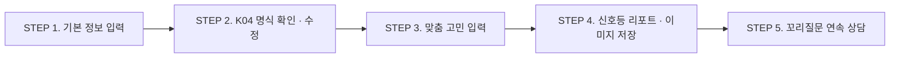
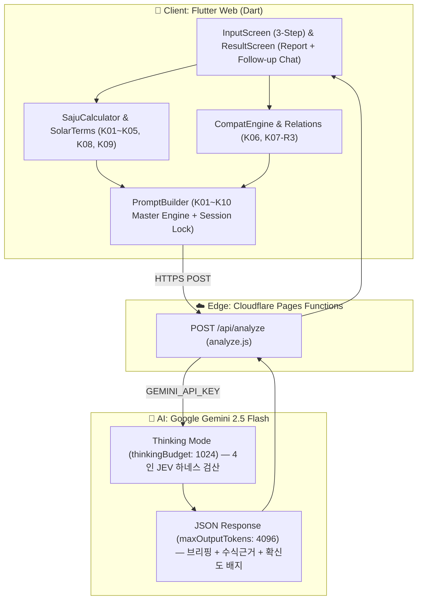

# 🌙 Fate Report (만세 리포트)

> **"뻔한 운세 자판기가 아닙니다. 정밀 만세력 수식(K01~K10)을 코드로 잠그고, 친한 전문가가 카톡으로 옆에서 조곤조곤 풀어주는 1:1 AI 사주·궁합 상담소"**

- 🌍 **실제 서비스 바로가기** : **[https://fate-report.pages.dev](https://fate-report.pages.dev)**
- 📦 **GitHub 저장소** : [https://github.com/jooyong0125-jpg/fate-report](https://github.com/jooyong0125-jpg/fate-report)

---

## 💡 처음 오신 분들을 위한 10초 요약: 이 앱은 무엇이 다른가요?

누구에게나 맞는 두루뭉술한 좋은 말, 알 수 없는 한자 나열, 읽고 나면 남는 게 없는 3줄 요약에 지치셨나요?  
**Fate Report**는 기존 AI 운세 서비스의 3가지 고질적인 문제를 **결정론적 코드 엔진(Dart)**과 **K01~K10 마스터 프롬프트 · 4인 전문가 하네스(JEV)**의 결합으로 해결한 웹 애플리케이션입니다.

| 기존 AI 사주·궁합 서비스의 한계 | ✨ `Fate Report`의 해결 방식 (Double Lock 아키텍처) |
| :--- | :--- |
| **1. 만세력 환각 (사주 글자 지어내기)**<br>AI가 생년월일로 60갑자를 암산하다가 절기·진태양시를 틀려 엉뚱한 사주를 풀이함 | **[K01~K05, K08] 코드 선계산 + STEP 2 직접 수정 안전장치**<br>앱 코드(`SajuCalculator`)가 절기월·서머타임·진태양시(-32분)·지장간·십성·12운성·대운까지 **100% 코드로 선계산**하여 잠그고(`K04`), 경계 시간대 감지 및 **만세력 글자 직접 수정 기능**까지 제공합니다. |
| **2. 주먹구구식 궁합 점수**<br>띠나 일주 2글자만 대충 비교하거나, 물어볼 때마다 AI 기분에 따라 점수가 65점↔85점으로 바뀜 | **[K07-R3] 100점 만점 정량 기계채점표 & 수식 실명제**<br>코드(`CompatEngine`)가 양측 3주 6글자(시간 확인 시 8글자) 전체를 교차 대조해 **1점의 오차도 없이 동일한 점수와 신호등**을 산출하고, `기본 25점 + 일지 육합 +10점`처럼 **가감 근거를 투명하게 공개**합니다. |
| **3. 기계적인 3줄 요약 & 단절된 상담**<br>매번 똑같은 `[장점] • ... [단점] • ...` 체크리스트만 보여주고 한 번 결과 보면 끝남 | **투트랙(Two-Track) 카톡형 브리핑 + 실시간 꼬리질문**<br>첫 문장에 명확한 결론부터 제시한 뒤 **친한 전문가가 카톡으로 이야기해 주듯 술술 읽히는 문단**으로 풀어주며, 리포트 하단에서 **바로 이어서 꼬리질문**을 주고받을 수 있습니다. |

---

## 🚀 한눈에 보는 앱 작동 흐름 (5-Step UX Pipeline)

방문자가 생년월일을 입력하고 리포트를 저장한 뒤, 후속 꼬리질문까지 이어가는 전체 흐름입니다.



1. **STEP 1 · 기본 정보 입력 (`InputScreen`)**: 이름/닉네임, 성별, 양력/음력 생년월일, 출생시간(또는 시간 미상), 출생 도시(진태양시 경도 보정용), 상대와의 관계 상태를 입력합니다.
2. **STEP 2 · K04 명식 확인 및 직접 수정**: 자동 계산된 4주 8글자(한글·한자), 6글자 본기 오행 분포, 대운 흐름을 확인합니다. 절입일 전후 48시간·시지 경계 30분·23시 야자시 구간은 **K05/K08 경계 알림**이 표시되며, 알고 계신 만세력 글자로 **직접 수정·고정(`Manual Override`)**할 수 있습니다.
3. **STEP 3 · 고민 입력**: `궁합 신호등`, `연애·속마음`, `반복 패턴·진로·재물`, `내 사주·대운·세운 종합` 4대 카테고리에 맞춰 궁금한 고민을 적거나 추천 질문 칩을 선택합니다.
4. **STEP 4 · 마스터 브리핑 & 이미지 저장 (`ResultScreen`)**: 상단 핵심 결론/궁합 신호등 게이지와 함께 깊이 있는 **투트랙 마스터 브리핑**, **지금 바로 해볼 현실 전략**, **`[적용 기준 | 확신도]` 인증 배지**를 확인하고 공유용 이미지(PNG)로 저장합니다.
5. **STEP 5 · 이어서 물어보기 (꼬리질문 채팅)**: 리포트 바로 아래에서 *"올해(2026) vs 내년(2027) 흐름 비교해줘"*, *"명리학 근거로 자세히 설명해줘"*, *"결론만 한 줄로 요약해줘"* 등 꼬리질문을 던지면, 고정된 내 사주(`K04`)를 바탕으로 앞선 설명 반복 없이 핵심만 이어서 답해줍니다.

---

## 🧠 핵심 엔진 3대 설계 포인트

### 1) 질문 성격에 따라 옷을 갈아입는 「투트랙(Two-Track) 맞춤 브리핑」
- **Track A · 이야기체 카톡 브리핑 (`기본 사주` · `연애/속마음` · `반복 패턴`)**
  - 딱딱한 글머리 기호(`•`, `-`, `1.`)를 배제하고, **첫 문장에 질문에 대한 명확한 결론**부터 제시합니다.
  - 이어서 `내면 심리와 이유 → 현실에서 나타나는 모습 → 올해 흐름과 현실 조언`을 **2~4문장 단위의 줄바꿈**으로 다정하고 깊이 있게 풀어냅니다.
- **Track B · 한눈에 보이는 정량·비교 브리핑 (`궁합 신호등` · `연도/선택지 비교`)**
  - 상단에 **`[궁합 정량 요약: 총점 OO점 (신호등)]`**과 항목별 수식 근거를 먼저 제시한 뒤, **굵은 소제목**을 활용해 서로 끌리는 이유, 갈등 포인트, 대화 해법을 한눈에 들어오게 정리합니다.

### 2) 겉글자만 보지 않고 사람의 입체적 결을 읽는 「K09 실전 통변 4대 축 & K10 시기운」
단순히 "불(火)이 많다"는 식의 단편적 해석을 금지하고, 지지 속 숨은 글자(**지장간**)까지 꺼내어 4개의 입체 렌즈로 분석합니다.
- 🌡️ **축 1 · 마음의 계절과 온도 (`조후`)**: 태어난 계절(월지)의 한난조습을 통해 내 마음이 지치거나 안정감을 얻는 환경을 짚어냅니다.
- ⚖️ **축 2 · 고유 기질과 내면 체급 (`억부`)**: 10천간 고유의 성정과 버티는 힘·소모하는 힘의 균형을 통해 멘탈과 자존심 포인트를 읽습니다.
- 💞 **축 3 · 연애와 정서적 결 (`배우자궁·정서 호환`)**: 실제 주민등록 나이를 단정하지 않고, 내 에너지를 따뜻하게 품어줄 상대가 맞는지 함께 활동적으로 호흡할 상대가 맞는지 정서적 결을 판별합니다.
- 🔄 **축 4 · 일과 돈이 흐르는 길 (`에너지 유통 경로`)**: 특정 직업명에 가두지 않고 `식상생재(자율·전문성)`, `관인상생(조직·시스템)`, `상관패인(문제해결)` 등 내 무기가 가장 잘 발휘되는 업무 방식과 재물 전략을 설계합니다.
- ⏳ **+ 시간축 결합 (`K10 대운·세운·월운`)**: 타고난 원국 위에 10년 대운과 2026년 병오(丙午)년·2027년 정미(丁未)년 세운(`K03`)을 포개어 잡아야 할 기회와 관리할 리스크를 동시에 짚어줍니다.

### 3) 1점의 오차도 허용하지 않는 「K07-R3 궁합 기계채점표 & 4인 JEV 하네스」

#### 📐 `[K07-R3]` 궁합 100점 정량 수식 체계
- **A. 관계의 중심축 (`기본 25점`, 범위 `0~35점`)**: 양측 일지 1:1 비교 — `육합(+10) / 같은 일지(+3) / 충(-12) / 형·자형(-8) / 해(-6) / 파(-4)` *(※ 진·오·유·해 동일 일지 자형은 `+3`과 `-8` 동시 적용하여 `-5점`)*
- **B. 생각과 표현 방식 (`기본 11점`, 범위 `0~20점`)**: 양측 일간 관계(`천간합+6 / 상생+3 / 동오행+1 / 상극-2`) + 년·월간 4쌍 추가 천간합(`쌍당 +1, 최대 +3`)
- **C. 서로 부족한 부분의 보완 (`기본 12점`, 범위 `0~25점`)**: 시주·지장간을 제외한 **양측 3주 6글자(천간 3 + 지지 본기 3) 오행 분포** 산출 — 상대의 결핍(`0개`) 오행을 내가 `2개 이상` 보유 시 `+3`, 양방향 상호 보완 시 `+2`, 동일 오행 양측 과다(`≥2개`) 시 `-3` *(가점 최대 `+11`, 감점 최대 `-9`)*
- **D. 생활과 장기 안정성 (`기본 10점`, 범위 `0~20점`)**: 년·월지 4쌍 비교(`육합+3 / 충-3 / 형-2 / 해-2 / 파-1`) + 4글자 내 **3글자 완전 삼합·방합(`+4`)** / **직접 충 2회 이상(`-3`)** / **3글자 완전 삼형(`-5`)**
- **시주 보정 (`기본 0점`, 범위 `-5~+5점`)**: 양쪽 모두 출생시간 확인 시에만 시지·시간 합충 반영 *(한쪽이라도 시간 미상이면 감점 없이 양쪽 시주 모두 제외)*
- **신호등 판정**: `80~100점 🟢 GREEN` / `50~79점 🟡 YELLOW` / `0~49점 🔴 RED` / `정보 부족 ⚪ GRAY(보류)`

#### 🛡️ 내부 4인 전문가 하네스(JEV) 릴레이 검증
1. **하네스 1 (팩트·수식 감사관)**: 코드가 계산한 명식(`K04`)과 궁합 점수(`K07-R3`)를 잠그고 역산 환각을 차단합니다.
2. **하네스 2 (냉정한 반증 비평가)**: `BLIND-FIRST` 원칙으로 희망고문과 극단적 단정을 배제하고 기회·리스크 균형을 맞춥니다.
3. **하네스 3 (쉬운 말·유도리 전략가)**: 어려운 명리 용어를 일상 심리·대화 습관·현실 행동으로 번역합니다.
4. **하네스 4 (무삭제 최종 감시관)**: `K01~K10` 규칙 생략 여부를 감시하고 모든 답변 끝에 **`[적용 기준: K04, K06, K09... | 확신도: HIGH / MEDIUM / LOW]`** 인증 배지를 부여합니다.

---

## 🏗️ 시스템 아키텍처 & 디렉토리 구조



```text
lib/
  manseryeok/
    ganzhi.dart            천간·지지·오행·지장간·십성·12운성 표준 테이블 (K06, K09)
    solar_terms.dart       24절기 월지 산출, 절입 48시간 경계 감지, 대운수 계산 (K02, K04, K05)
    saju_calculator.dart   정밀 만세력 4주 산출, 대운 흐름, K05/K08 경계 감지, K04 상세 슬롯 포맷터
    birth_place.dart       한국 주요 도시 경도 및 진태양시(-32분 등) 보정
    dst_correction.dart    역대 한국 서머타임(일광절약시간) 보정
  compat/
    relations.dart         천간합·육합·충·형·자형·해·파 및 3글자 완전 삼합/방합/삼형 판별 (K06)
    compat_engine.dart     K07-R3 100점 정량 궁합 엔진 (A~D + 시주보정 + 수식 근거 생성)
  services/
    prompt_builder.dart    범용 사주·운세·궁합 마스터 엔진 (K01~K10 100% 무삭제 + 4인 JEV 하네스)
    ai_service.dart        초기 리포트 및 멀티턴 꼬리질문 API 호출 서비스
    mock_data.dart         오프라인/프리뷰용 K01~K10 규격 시뮬레이션 데이터
    app_state.dart         전역 상태 관리 (Provider)
  screens/
    home_screen.dart       홈 화면 (카테고리·신뢰 원칙·FAQ)
    input_screen.dart      3단계 입력 및 STEP 2 명식 확인/직접 수정(K04 Lock) 화면
    result_screen.dart     신호등 게이지 + 투트랙 마스터 브리핑 + 이미지 저장 + 꼬리질문 채팅 화면
  models/
    models.dart            사용자/상대 명식 프로필, 리포트 결과, 꼬리질문 채팅 모델
  content/
    copy.dart              서비스 문구 및 K07-R3 신호등 기준 안내
functions/
  api/analyze.js           Cloudflare Pages Function (Gemini 2.5 Flash 프록시, thinkingBudget: 1024)
```

---

## 🛠️ 빌드 및 실행 방법

```bash
# 패키지 설치
flutter pub get

# 1) 로컬 목업 모드 실행 (AI 키 없이도 K07-R3 정량 계산 및 마스터 브리핑 UI 즉시 확인)
flutter run -d chrome

# 2) 프로덕션 웹 빌드 (Cloudflare Pages Functions 프록시 연동)
flutter build web --release \
  --dart-define=USE_MOCK=false \
  --dart-define=AI_PROXY_URL=/api/analyze
```

> 🔐 **보안 안내**: `GEMINI_API_KEY`는 클라이언트 코드에 포함되지 않으며, Cloudflare Pages 환경변수(Secret)에만 안전하게 보관됩니다.

---

## ⚠️ 주의사항

본 서비스의 분석 결과는 만세력과 명리학적 구조 해석(`K01~K10`)을 바탕으로 한 참고용 리포트입니다. 건강·투자·법률·결혼·이별·합격·실패를 확정하는 절대적 판단 기준으로 사용하지 마세요.
